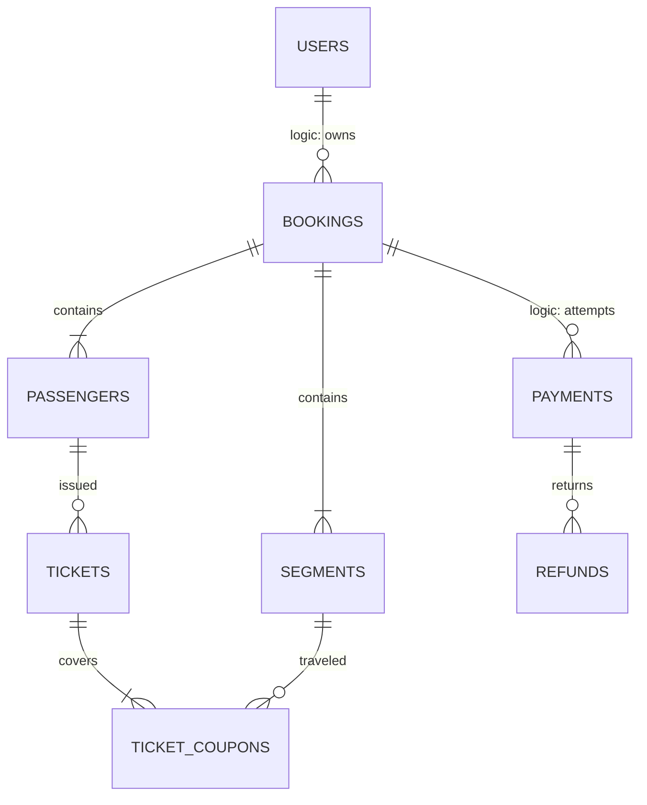
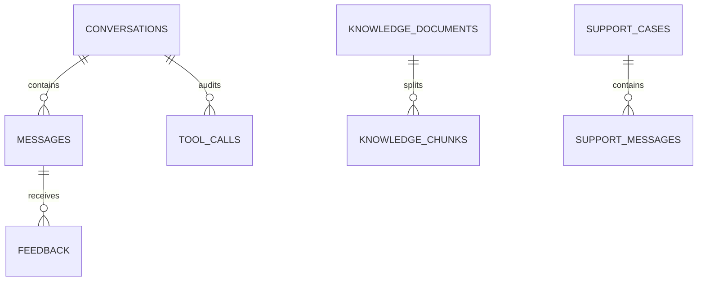

# Quan hệ dữ liệu

## Quan hệ vật lý trong cùng service

| Bảng con | Khóa ngoại / ràng buộc |
|---|---|
| `identity.user_roles` | `user_id uuid NOT NULL REFERENCES identity.users(id)` |
| `identity.user_roles` | `role_id uuid NOT NULL REFERENCES identity.roles(id)` |
| `identity.role_permissions` | `role_id uuid NOT NULL REFERENCES identity.roles(id)` |
| `identity.role_permissions` | `permission_id uuid NOT NULL REFERENCES identity.permissions(id)` |
| `identity.sessions` | `user_id uuid NOT NULL REFERENCES identity.users(id)` |
| `identity.verification_tokens` | `user_id uuid NOT NULL REFERENCES identity.users(id)` |
| `identity.oauth_accounts` | `user_id uuid NOT NULL REFERENCES identity.users(id)` |
| `identity.travelers` | `user_id uuid NOT NULL REFERENCES identity.users(id)` |
| `flight.routes` | `origin_id uuid NOT NULL REFERENCES flight.airports(id)` |
| `flight.routes` | `destination_id uuid NOT NULL REFERENCES flight.airports(id)` |
| `flight.offers` | `search_id uuid NOT NULL REFERENCES flight.searches(id)` |
| `flight.offers` | `supplier_id uuid NOT NULL REFERENCES flight.suppliers(id)` |
| `flight.offer_segments` | `offer_id uuid NOT NULL REFERENCES flight.offers(id)` |
| `flight.offer_segments` | `origin_id uuid NOT NULL REFERENCES flight.airports(id)` |
| `flight.offer_segments` | `destination_id uuid NOT NULL REFERENCES flight.airports(id)` |
| `flight.offer_segments` | `airline_id uuid NOT NULL REFERENCES flight.airlines(id)` |
| `booking.passengers` | `booking_id uuid NOT NULL REFERENCES booking.bookings(id)` |
| `booking.passengers` | `FOREIGN KEY(booking_id,associated_adult_id) REFERENCES booking.passengers(booking_id,id)` |
| `booking.segments` | `booking_id uuid NOT NULL REFERENCES booking.bookings(id)` |
| `booking.ancillaries` | `booking_id uuid NOT NULL REFERENCES booking.bookings(id)` |
| `booking.ancillaries` | `FOREIGN KEY(booking_id,passenger_id) REFERENCES booking.passengers(booking_id,id)` |
| `booking.ancillaries` | `FOREIGN KEY(booking_id,segment_id) REFERENCES booking.segments(booking_id,id)` |
| `booking.price_lines` | `booking_id uuid NOT NULL REFERENCES booking.bookings(id)` |
| `booking.reservations` | `booking_id uuid NOT NULL REFERENCES booking.bookings(id)` |
| `booking.tickets` | `booking_id uuid NOT NULL REFERENCES booking.bookings(id)` |
| `booking.tickets` | `FOREIGN KEY(booking_id,passenger_id) REFERENCES booking.passengers(booking_id,id)` |
| `booking.ticket_coupons` | `booking_id uuid NOT NULL REFERENCES booking.bookings(id)` |
| `booking.ticket_coupons` | `FOREIGN KEY(booking_id,ticket_id) REFERENCES booking.tickets(booking_id,id)` |
| `booking.ticket_coupons` | `FOREIGN KEY(booking_id,segment_id) REFERENCES booking.segments(booking_id,id)` |
| `booking.change_requests` | `booking_id uuid NOT NULL REFERENCES booking.bookings(id)` |
| `booking.status_history` | `booking_id uuid NOT NULL REFERENCES booking.bookings(id)` |
| `payment.refunds` | `payment_id uuid NOT NULL REFERENCES payment.payments(id)` |
| `payment.reconciliation_cases` | `payment_id uuid REFERENCES payment.payments(id)` |
| `engagement.promotion_redemptions` | `promotion_id uuid NOT NULL REFERENCES engagement.promotions(id)` |
| `notification.delivery_attempts` | `notification_id uuid NOT NULL REFERENCES notification.notifications(id)` |
| `assistant.messages` | `conversation_id uuid NOT NULL REFERENCES assistant.conversations(id)` |
| `assistant.tool_calls` | `conversation_id uuid NOT NULL REFERENCES assistant.conversations(id)` |
| `assistant.tool_calls` | `message_id uuid REFERENCES assistant.messages(id)` |
| `assistant.knowledge_chunks` | `document_id uuid NOT NULL REFERENCES assistant.knowledge_documents(id)` |
| `assistant.feedback` | `message_id uuid NOT NULL REFERENCES assistant.messages(id)` |
| `support.messages` | `case_id uuid NOT NULL REFERENCES support.cases(id)` |

## Tham chiếu logic giữa service

| Nguồn | Đích / cardinality | Cách kiểm tra |
|---|---|
| booking.bookings.user_id | identity.users.id; user 1:N bookings | JWT subject + Identity API khi cần |
| booking.bookings.offer_id / supplier_id | flight.offers / suppliers; offer 1:N bookings | Flight reprice API; snapshot được giữ dù offer hết TTL |
| booking.passengers.traveler_id | identity.travelers.id; traveler 1:N snapshots | Kiểm tra sở hữu khi sao chép |
| payment.payments.booking_id / change_request_id | booking.bookings / change_requests; booking 1:N payments | Booking payment intent contract + event |
| payment.refunds.change_request_id | booking.change_requests.id; request 1:N refunds | Saga + correlation ID |
| engagement.promotion_redemptions.booking_id / user_id | booking / identity | API reserve/commit/release và event |
| notification.notifications.user_id / booking_id | identity / booking | Events; dữ liệu tối thiểu |
| assistant.conversations.user_id / booking_id | identity / booking | Auth + kiểm tra quyền tại Booking API |
| support.cases.user_id / assigned_to / booking_id / conversation_id | identity / booking / assistant | API + event handoff; không join trực tiếp DB |
| flight.searches.user_id | identity.users.id, nullable cho khách chưa đăng nhập | Server lấy JWT subject, không tin user_id từ body |
| Các actor_id/requested_by/author_id | identity.users.id | Gateway + từng service xác thực quyền |

## Các quan hệ cốt lõi

Quan hệ trong hai sơ đồ rút gọn; bảng phía trên liệt kê ràng buộc đầy đủ. Các đường ghi logic không có FOREIGN KEY vật lý. Coupon và seat phải kiểm tra với supplier/service chủ sở hữu; không thể suy ra tồn chỗ toàn hệ thống từ database nội bộ.