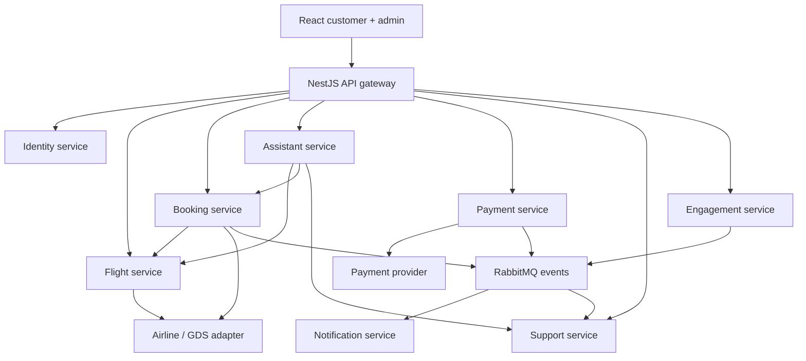
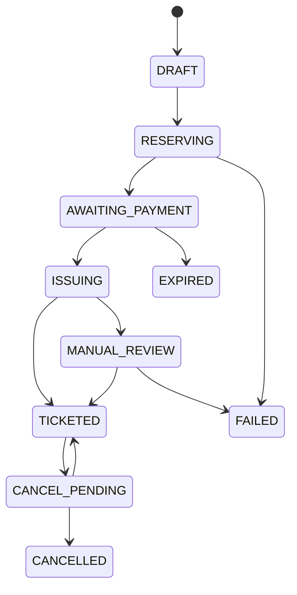

# Skyvia — mô tả và kiến trúc hệ thống

## 1. Phạm vi và giả định

Skyvia là nền tảng trung gian đặt vé máy bay: người dùng tìm chuyến, so sánh giá, đặt vé một chiều/khứ hồi, thanh toán, xem vé, gửi yêu cầu đổi/hủy và hỏi trợ lý AI bằng tiếng Việt. Hệ thống không vận hành tồn chỗ của hãng. Hãng bay/nhà cung cấp là nguồn xác thực về giá, chỗ, điều kiện vé, PNR và số vé.

Ba nhóm người dùng: CUSTOMER, SUPPORT và ADMIN. SUPPORT được truy cập hồ sơ/booking theo nhiệm vụ; quyền duyệt hoàn tiền, thay đổi cấu hình và phân quyền tách riêng. Chọn đăng nhập trước khi đặt vé để giảm phạm vi MVP. Khách chưa đăng nhập vẫn được tìm kiếm và đọc FAQ; chatbot cá nhân hóa cần đăng nhập.

32 màn hình desktop được đặc tả ở SCREEN-CATALOG.md. Mobile áp dụng responsive cho cùng route: filter chuyển thành drawer, summary thành sticky bottom bar, bảng thành card; không phải bộ ảnh mobile riêng. Đa chặng được chuẩn bị trong dữ liệu nhưng UI multi-city, loyalty, vé đoàn, B2B đại lý và check-in trực tiếp nằm ngoài bộ MVP này.

## 2. Năng lực nghiệp vụ

| Miền | Chức năng | Nguồn xác thực |
|---|---|---|
| Tài khoản | Đăng ký, xác minh, đăng nhập, reset, session, hồ sơ, khách lưu sẵn | Identity service |
| Chuyến bay | Airport autocomplete, tìm kiếm, lọc, so sánh hạng vé, reprice, sơ đồ ghế | Flight service → supplier |
| Đặt vé | Snapshot hành khách/chặng/giá, giữ chỗ nếu hỗ trợ, xuất vé, đổi/hủy | Booking service → supplier |
| Thanh toán | Tạo lần thanh toán, xác minh webhook, hoàn tiền, đối soát | Payment service → payment provider |
| Tương tác | Coupon, nội dung, banner, điều khoản | Engagement service |
| Thông báo | In-app, email, optional SMS | Notification service |
| AI | Tìm chuyến qua tool, RAG chính sách, theo dõi vé cá nhân, chuyển nhân viên | Assistant service + domain APIs |
| CSKH | Hộp thư, ticket, ghi chú nội bộ, audit quản trị | Support service |

## 3. Topology microservices

Các đường API là HTTPS đồng bộ; các domain event qua RabbitMQ là bất đồng bộ. Gateway xử lý routing, JWT validation, rate limit, request ID và streaming; không giữ nghiệp vụ booking hoặc truy vấn trực tiếp database. Service tự kiểm tra quyền, dữ liệu đầu vào và state transition dù gateway đã kiểm tra.

| Service | Schema sở hữu | Giao tiếp và trách nhiệm chính |
|---|---|---|
| api-gateway | Không có bảng nghiệp vụ | REST /api/v1, SSE chat và trạng thái booking, webhook routing giữ nguyên raw body |
| identity-service | identity | API hồ sơ/auth; JWT asymmetric, rotation refresh token |
| flight-service | flight | REST search/reprice/seat map; supplier adapter với timeout/circuit breaker |
| booking-service | booking | Booking saga, giữ chỗ, xuất vé, đổi/hủy; consume payment events |
| payment-service | payment | Checkout/webhook/refund/reconciliation; consume refund commands |
| engagement-service | engagement | Coupon reservation/commit/release, nội dung và điều khoản |
| notification-service | notification | Consume events; email/in-app/SMS; retry delivery |
| assistant-service | assistant | LLM tool loop, RAG, conversation, feedback, tool audit |
| support-service | support | CSKH, admin audit, dashboard tổng hợp qua API/read projection |

Dùng một PostgreSQL instance với 8 schema ở local; mỗi service có role và migrations riêng. Production có thể tách thành database riêng. Không có cross-service foreign key, không dùng Prisma relation xuyên miền để join. Dashboard dùng API aggregation ban đầu; khi cần báo cáo lớn mới tạo reporting projection từ event.

## 4. Luồng tìm kiếm và đặt vé

1. React gửi sân bay, ngày, số người lớn/trẻ em/em bé và hạng cabin. Server kiểm tra ngày, giới hạn hành khách và tính hợp lệ tuyến.
2. Flight service gọi supplier adapter, chuẩn hóa offer, lưu metadata có TTL và trả `offerId`, `expiresAt`, giá/currency, điều kiện và các chặng. Khi một supplier lỗi, trả trạng thái PARTIAL thay vì giả lập kết quả thật.
3. Người dùng chọn một offer đầy đủ gồm cả lượt đi/lượt về. Server reprice trước khi tạo booking; nếu giá/điều kiện đổi, trả quote mới để khách chấp nhận lại.
4. Booking sao chép offer, hành khách, chặng, giá và phiên bản điều khoản. Ghế/hành lý là tùy chọn theo khả năng supplier. Seat map không phải bằng chứng đã giữ ghế.
5. Nếu supplier hỗ trợ hold, tạo reservation và lưu deadline thực tế. Nếu không hỗ trợ hold, UI ghi rõ giá/chỗ còn cần xác nhận; không hiển thị giữ chỗ chắc chắn.
6. Payment tạo checkout từ tổng tiền server. Supplier deadline và payment deadline phải có khoảng đệm đủ cho xuất vé; không tự chọn deadline dài hơn thời hạn supplier.
7. Webhook hợp lệ cập nhật Payment và outbox trong một transaction. Booking consume `payment.succeeded`, kiểm tra currency/amount/booking rồi thực hiện xuất vé bằng request key ổn định.
8. Khi supplier trả số vé, Booking lưu ticket/coupon, chuyển TICKETED, phát event. Notification gửi email và in-app. UI phân biệt PNR, mã booking nội bộ và số vé; chúng không đồng nghĩa.

### Các trạng thái

Đây là các nhánh chính, không thay thế bảng transition có guard trong code. DRAFT có thể bị hủy/lỗi trước khi trả tiền. Trạng thái tiền thuộc Payment: PENDING → SUCCEEDED/FAILED/EXPIRED; sau thành công có REFUND_PENDING/PARTIALLY_REFUNDED/REFUNDED. Không chuyển payment thành FAILED khi xuất vé lỗi.

### Xử lý lỗi bắt buộc

| Tình huống | Hành vi hệ thống |
|---|---|
| Offer hết hạn hoặc giá tăng | Reprice, tạo quote mới, cần khách xác nhận; không âm thầm thu thêm |
| Webhook trùng/đến sai thứ tự | Xác minh chữ ký raw body; unique(provider,event_id); state transition có guard; tra cứu provider nếu không rõ |
| Callback frontend báo thành công | Chỉ hiển thị đang xác minh; không dùng redirect làm bằng chứng đã nhận tiền |
| Thanh toán đến sau khi booking hết hạn | Không tự xuất vé bằng offer cũ; đối soát, refund hoặc xin khách chấp nhận quote mới |
| Supplier timeout khi tạo order/xuất vé | Đặt UNKNOWN/MANUAL_REVIEW; tra cứu bằng request key/order ref trước khi retry để tránh vé trùng |
| Đã thu tiền nhưng xuất vé thất bại chắc chắn | Ghi lý do, tạo refund saga và thông báo; không báo đã có vé |
| Chỉ xuất được một phần hành khách | MANUAL_REVIEW, ghi từng ticket; không gắn TICKETED cho toàn booking khi thiếu vé |
| Ghế bị người khác lấy | Supplier reject; đề nghị ghế khác, hoàn phí dịch vụ nếu cần; unique nội bộ chỉ ngăn xung đột trong booking |
| Hủy vé thành công, hoàn tiền thất bại | Booking vẫn CANCELLED; refund ở FAILED/MANUAL_REVIEW, nhân viên xử lý tiếp |
| Đổi vé cần trả thêm | Quote có hạn → khách xác nhận → payment purpose CHANGE → đổi vé; bảo toàn snapshot và lịch sử vé cũ |

Coupon dùng reserve/commit/release với TTL. Kiểm tra usage_limit/per_user_limit trong transaction khóa promotion; release khi booking hết hạn. Tổng refund dùng transaction khóa payment; kiểm tra tổng REQUESTED/PROCESSING/SUCCEEDED không vượt số đã thu, không chỉ kiểm tra từng dòng.

## 5. Event reliability và consistency

PostgreSQL transaction bảo vệ một service; không có distributed transaction qua RabbitMQ. Dùng outbox/inbox, consumer idempotent, manual ack sau commit, retry có backoff và dead-letter queue. Outbox publish rồi mới đánh dấu published; crash ở giữa có thể phát trùng, consumer phải chịu được.

Envelope chuẩn: `eventId`, `eventType`, `eventVersion`, `aggregateId`, `aggregateVersion`, `occurredAt`, `correlationId`, `causationId`, `producer`, `payload`. DDL outbox lưu phần payload/envelope cần thiết; khi publish thêm producer/causationId từ metadata trong payload. Event không chứa passport hay refresh token. Payload có version; không sửa phá vỡ consumer cũ.

Event chính: `booking.created`, `booking.payment_requested`, `payment.succeeded`, `payment.failed`, `booking.ticketed`, `booking.issue_failed`, `booking.expired`, `booking.cancelled`, `refund.requested`, `refund.succeeded`, `refund.failed`, `promotion.reserved`, `support.handoff_requested`. Cùng một aggregate dùng version để phát hiện stale events; không dựa vào thứ tự toàn cục của broker. Booking là orchestrator saga; từng command ghi idempotency key và side-effect result để retry an toàn.

## 6. Thiết kế chatbot AI

AI là lớp điều phối hội thoại. Giá và tình trạng vé phải lấy qua domain tool; chính sách lấy từ tài liệu đã duyệt, có nguồn và ngày hiệu lực. RAG không được dùng để đoán giá/chỗ hiện tại.

Ví dụ: “Tìm vé Hà Nội đi Đà Nẵng tối thứ Sáu tuần sau, dưới 3 triệu, có hành lý”. AI làm rõ thiếu ngày hoặc số khách, quy đổi ngày theo timezone người dùng, hiển thị ngày tuyệt đối trước khi tìm; gọi `search_flights`, trả flight cards và link chọn offer.

| Tool | Kiểu | Điều kiện thực thi |
|---|---|---|
| search_flights / reprice_offer | Đọc | Input có schema, deadline, giới hạn số kết quả |
| search_policies | Đọc | Chỉ tài liệu PUBLISHED, đúng audience/hãng/ngày; kèm citation |
| get_my_bookings / get_booking_status | Đọc cá nhân | Server tự lấy userId từ auth context; kiểm tra sở hữu từng booking |
| quote_change / quote_cancellation | Đọc cá nhân | Trả chi phí, điều kiện và quote expiry; chưa thực hiện thay đổi |
| prepare_booking | Chuẩn bị | Tạo draft gắn user; hiển thị hành trình, giá và điều khoản |
| confirm_booking / confirm_change / confirm_cancel | Ghi | Token xác nhận một lần gắn user, quote hash, hành động, expiry; khách bấm xác nhận rõ ràng |
| create_support_case / handoff | Ghi | Khách đồng ý gửi nội dung cần thiết; có audit |

Vòng lặp: nhận message → kiểm tra quyền và budget → model đề xuất tool với JSON Schema strict → backend validate bằng Zod/class-validator → policy authorization → thực thi tool → trả kết quả tool → model diễn giải → lưu citations và tool audit. Strict schema giúp cấu trúc đầu vào; không thay thế authorization hoặc kiểm tra nghiệp vụ.

Backend không chấp nhận `user_id`, số tiền hoặc trạng thái “đã thanh toán” do model tự đưa ra. Không cho model chạy SQL, truy cập secret hoặc gọi HTTP tùy ý. Nội dung retrieved là dữ liệu không tin cậy; bỏ chỉ dẫn yêu cầu vượt quyền nằm trong tài liệu. Mask PII trước khi gửi LLM; không gửi passport đầy đủ, token hay thông tin thẻ. Giới hạn số tool call/token, timeout, log đã redaction và tắt tool ghi khi mất xác thực.

Tri thức: upload PDF/HTML → scan/parse → tạo version DRAFT → chunk + embedding → retrieval test → nhân viên duyệt → PUBLISHED. Lưu document/version/source; lọc ngày hiệu lực trước khi trả lời. Nếu thiếu nguồn hoặc mâu thuẫn, AI nói rõ và chuyển CSKH. Dùng pgvector tùy chọn; dimension trong optional-vector.sql là cấu hình 1536 của thiết kế, phải khớp model embedding đã chọn.

SSE dùng cho token stream và tool progress; reconnect với cursor cho message/status. CSKH nhận support case và conversation context qua event, sau đó phát tin nhắn agent qua kênh hội thoại. Khi status HANDOFF, bot dừng tự trả lời trừ thông báo hệ thống.

## 7. Thư viện và hạ tầng đề xuất

Đây là bộ lựa chọn kiến trúc, không khóa phiên bản giả định. Khi khởi tạo repository, chọn các bản stable tương thích tại thời điểm cài, pin lockfile và ghi Node engine. Kiểm tra tài liệu migration của Prisma/Nest trước khi nâng major.

| Lớp | Thư viện / công cụ | Mục đích |
|---|---|---|
| Monorepo | pnpm workspaces + Turborepo | Chạy build/lint/dev theo dependency graph |
| Frontend | React, TypeScript, Vite, react-router | SPA khách hàng và admin |
| Server state | @tanstack/react-query | Cache request, invalidation, retry có chọn lọc |
| Form | react-hook-form, zod, @hookform/resolvers | Validate form và lỗi field |
| UI | tailwindcss, shadcn/ui, lucide-react | Design tokens và accessible primitives; shadcn là component source |
| State cục bộ | zustand | Search draft, booking wizard; không lưu token ở localStorage |
| Tiện ích | date-fns, date-fns-tz, i18next, react-i18next | Timezone và ngôn ngữ; Intl.NumberFormat cho giá |
| Admin | @tanstack/react-table, recharts | Table/filter/chart; aggregate dữ liệu server |
| Backend | @nestjs/common/core/config/platform-express | Cấu trúc service và dependency injection |
| API | @nestjs/swagger, class-validator, class-transformer | OpenAPI và validation DTO |
| Auth | @nestjs/jwt, jose, argon2 | JWT ký bất đối xứng, password hash; key rotation qua JWKS |
| Data | prisma, @prisma/client, @prisma/adapter-pg, pg | Client/migration riêng mỗi service; setup adapter theo version đã chọn |
| Messaging | @nestjs/microservices, amqplib, amqp-connection-manager | RabbitMQ transporter; manual ack/durable queues |
| Jobs/cache | ioredis, bullmq, @nestjs/bullmq | Cache TTL, scheduler cleanup, delivery retry; Redis không làm nguồn tồn chỗ |
| AI | openai, zod, pg | Tool loop trực tiếp; LangChain chưa cần ở MVP |
| Object storage | @aws-sdk/client-s3 | E-ticket, tài liệu tri thức; signed URL có hạn |
| Email | nodemailer hoặc SDK nhà cung cấp | Sandbox email ở local, provider thật ở production |
| Quan sát | nestjs-pino, pino, OpenTelemetry, Prometheus/Grafana | Structured logs, tracing gateway→supplier, metrics |
| Kiểm thử | Vitest/Testing Library, Jest hoặc Vitest backend, Supertest, Playwright, Testcontainers | Unit nghiệp vụ, integration PostgreSQL/RabbitMQ, E2E |
| Local infra | Docker Compose: PostgreSQL, Redis, RabbitMQ, MinIO, Mailpit | Phát triển; mock supplier và payment adapter |

Payment chọn một provider phù hợp khả năng merchant tại thị trường triển khai: VNPay hoặc MoMo là ứng viên cho Việt Nam; hosted checkout của provider nếu hỗ trợ. Stripe chỉ là ví dụ tham chiếu webhook, không mặc định coi merchant Việt Nam được mở tài khoản. Không lưu PAN/CVV; redirect/hosted payment thuộc provider. Các phương thức trong ảnh là mục tiêu UX, chỉ bật khi hợp đồng và API hỗ trợ.

## 8. Cấu trúc repository

| Đường dẫn | Nội dung |
|---|---|
| apps/web | React khách hàng, feature folders: auth/search/booking/trips/chat/account |
| apps/admin | React admin và CSKH, permission-based routes |
| apps/api-gateway | Routing, auth boundary, OpenAPI, SSE |
| apps/identity-service | Modules và prisma/migrations của identity |
| apps/flight-service | Catalog, search, pricing, adapters, prisma/migrations |
| apps/booking-service | Booking aggregate, saga, supplier order/ticket adapters |
| apps/payment-service | Checkout, webhook, refund, reconciliation |
| apps/engagement-service | Coupon và CMS |
| apps/notification-service | In-app và email worker |
| apps/assistant-service | Conversations, tools, retrieval, model adapter |
| apps/support-service | Cases, inbox và audit |
| packages/contracts | DTO công khai, event schema/version, error codes; không export Prisma entities |
| packages/ui | Components/tokens dùng chung React |
| packages/config | ESLint, tsconfig, test config |
| infra/compose | Local database/broker/cache; env.example không chứa secret |
| docs | Quyết định kiến trúc, API, schema và screen catalog |

Mỗi service có Dockerfile và pipeline riêng; monorepo không đồng nghĩa chung runtime hay chung database client. Tránh shared package chứa nghiệp vụ để service không bị ràng buộc triển khai đồng thời.

## 9. API baseline

Tất cả đường dưới đây thêm prefix `/api/v1`. User ID lấy từ auth context. OpenAPI là hợp đồng frontend; lỗi trả `{code,message,fieldErrors,requestId}`. Các mutation tiền/booking/đổi/hủy cần `Idempotency-Key`; cùng key khác payload trả conflict. Cursor opaque encode `(createdAt,id)` với limit mặc định 20, tối đa 100 cho danh sách cá nhân.

| Nhóm | API chính |
|---|---|
| Auth | POST /auth/register, /auth/login, /auth/verify-email, /auth/forgot-password, /auth/reset-password, /auth/refresh, /auth/logout |
| Hồ sơ | GET/PATCH /me; GET /me/sessions; DELETE /me/sessions/:id; CRUD /me/travelers |
| Flights | GET /airports?q=; POST /flight-searches; GET /flight-searches/:id/offers; GET /offers/:id; POST /offers/:id/reprice; GET /offers/:id/seat-map |
| Booking wizard | POST /bookings; PATCH /bookings/:id/passengers; PATCH /bookings/:id/ancillaries; POST /bookings/:id/confirm |
| Thanh toán | POST /bookings/:id/payments; GET /payments/:id; POST /webhooks/payments/:provider |
| Trips | GET /me/bookings; GET /bookings/:id; GET /bookings/:id/tickets/:ticketId/download; GET /bookings/:id/events (SSE) |
| Đổi/hủy | POST /bookings/:id/change-quotes; POST /bookings/:id/cancel-quotes; POST /change-requests/:id/confirm |
| Chat | POST /conversations; GET /conversations/:id/messages; POST /conversations/:id/messages; GET /conversations/:id/events; POST /tool-calls/:id/confirm |
| Tương tác | GET /promotions; POST /bookings/:id/promotion; GET /me/notifications; PATCH /me/notifications/:id/read |
| CSKH | POST /support/cases; GET /me/support/cases; GET/POST /support/cases/:id/messages; POST /conversations/:id/handoff |
| Admin | GET /admin/dashboard; GET /admin/bookings; GET /admin/payments; GET /admin/refunds; POST /admin/refunds/:id/approve; CRUD /admin/users, /admin/roles, /admin/promotions, /admin/content; GET/PATCH /admin/support/cases/:id; CRUD /admin/knowledge; POST /admin/knowledge/:id/publish; GET/PATCH /admin/suppliers/:id |

Admin API cần permission cụ thể và audit. Đọc dữ liệu khách theo support case scope; không cho role SUPPORT đổi role user hoặc duyệt refund nếu thiếu quyền. Endpoint download trả signed URL sau ownership check, không public object key.

## 10. Quy tắc dữ liệu và vận hành

44 bảng nghiệp vụ + 16 inbox/outbox = 60 bảng trong 8 schema. DDL là baseline; các CHECK/FK/UNIQUE bảo vệ dữ liệu cục bộ. Các tổng số tiền xuyên dòng, tính hợp lệ ADT/CHD/INF theo ngày bay, trẻ sơ sinh gắn đúng người lớn, tối đa hành khách, quorum xuất đủ vé, payment transition và supplier rule phải kiểm tra ở service transaction và integration test.

`updated_at` được trigger tự cập nhật. Cursor index cho bookings/messages/notifications. Payment provider event dedup bằng unique key. TTL cleanup xóa offer segment trước offer/search hoặc dùng migration retention phù hợp; booking giữ snapshot nên không bị ảnh hưởng. Không xóa booking/ticket/payment lịch sử bằng cascade.

Auth: refresh token hash trong DB, cookie HttpOnly/Secure/SameSite cấu hình theo deployment, CSRF protection cho mutation dùng cookie; access token ngắn hạn chỉ giữ trong memory nếu dùng bearer. Validate issuer/audience/expiry; kiểm tra session revoke cho hành động nhạy cảm. Mã OTP/reset có hạn, một lần, giới hạn attempts và rate limit theo user/IP. OAuth dùng authorization code + PKCE/state/nonce theo provider. CORS allowlist, HTTPS, secret manager và rotation.

Tách dữ liệu hồ sơ mã hóa, transcript đã redaction và audit. Log không ghi token, passport hay thông tin thẻ. RBAC database deny UPDATE/DELETE cho audit role; application role không được coi là bằng chứng audit bất biến nếu còn quyền owner. Lập retention theo chính sách vận hành/địa phương trước production; không tự gán thời hạn pháp lý trong mẫu.

Metrics: search latency/error theo supplier, reprice mismatch, payment verification delay, ticket issuance latency, số booking MANUAL_REVIEW, outbox lag, DLQ depth, refund pending, AI tool error/hallucination đánh giá trên tập test có nhãn. Có timeout và circuit breaker supplier, backup database, restore drill và runbook xử lý tiền đã thu nhưng chưa có vé.

## 11. Lộ trình triển khai để học và xây dựng

1. Khởi tạo monorepo + Compose, contract conventions, logs và migrations. Tạo tất cả service skeleton nhưng chỉ bật service cần cho vertical slice.
2. Identity và Flight với mock supplier: login → search → detail; frontend bám template 01–08.
3. Booking + Payment sandbox: passenger → reprice → checkout → webhook → ticket giả có nhãn DEMO. Chưa dùng tiền thật.
4. Outbox/inbox, retry/DLQ và integration tests cho duplicate webhook, supplier timeout, payment đến muộn, refund giới hạn và hai request xác nhận đồng thời.
5. AI search + RAG read-only trước; đo chất lượng rồi thêm draft/confirm tools. Kiểm thử truy cập booking người khác và prompt injection từ tài liệu.
6. My trips, admin, coupon, CSKH và notification. Đổi/hủy là yêu cầu xử lý thủ công trước nếu provider chưa hỗ trợ tự động.
7. Ký hợp đồng supplier/payment, live adapter, đối soát và pilot giới hạn trước mở production. Tính năng đổi/hủy/chọn ghế phải dựa vào capability thực tế của adapter.

## 12. Nguồn tham khảo chính thức

Đã đối chiếu ngày 11/11/2026. Các lựa chọn kiến trúc ở trên là đề xuất cho Skyvia, không phải yêu cầu bắt buộc của các thư viện.

- NestJS RabbitMQ transporter: https://docs.nestjs.com/microservices/rabbitmq
- React + build tools/Vite: https://react.dev/learn/build-a-react-app-from-scratch
- Amadeus Flight APIs: https://github.com/amadeus4dev/developer-guides/blob/master/docs/resources/flights.md
- Amadeus production/ticket issuance requirements: https://amadeus4dev.github.io/developer-guides/faq/
- OpenAI function calling / strict schema: https://developers.openai.com/api/docs/guides/function-calling
- Webhook signature, duplicate và unordered delivery: https://docs.stripe.com/webhooks
- PostgreSQL constraints: https://www.postgresql.org/docs/current/ddl-constraints.html
- pgvector: https://github.com/pgvector/pgvector

Amadeus Self-Service Flight Create Orders production yêu cầu hợp đồng consolidator để xuất vé theo FAQ; adapter/provider khác có điều kiện riêng. API tìm kiếm hoặc sandbox hoạt động không đồng nghĩa hệ thống đã được phép xuất vé thật.
